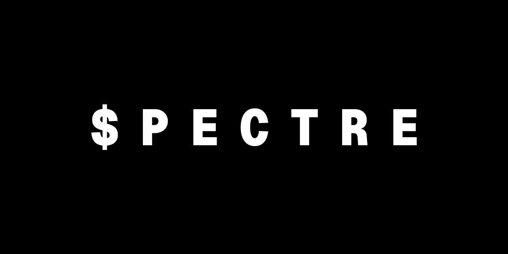

# $PECTRE

App Android local para planejar o mês: divisão do salário em custos, reserva e investimento, áreas com valor planejado, contas fixas e metas com previsão.

Os dados ficam só no celular (Room/SQLite). Em **Ajustes → Dados** é possível salvar uma cópia em JSON e restaurá-la.

## Instalar

1. Abra a página **Releases** do repositório no celular e baixe o `spectre-1.0.N.apk` mais recente.
2. Toque no arquivo. Na primeira vez, o Android pede permissão para instalar apps desta fonte.
3. As versões novas instalam por cima e mantêm os dados, porque todas são assinadas com a mesma chave.

## Como o APK é gerado

Cada push na `main` dispara o workflow `.github/workflows/android.yml`, que:

- roda os testes de regras (`app/src/test`);
- gera o APK assinado;
- publica o APK como artefato do workflow e em **Releases**.

Ele também pode ser disparado manualmente em **Actions → APK → Run workflow**.

### Chave de assinatura

A chave vem do secret `KEYSTORE_BASE64` (o `.jks` em base64) e a senha, do secret `KEYSTORE_PASSWORD`. Sem os dois, o workflow para com erro. A chave nunca fica no repositório (`keystore/*.jks` está no `.gitignore`), e não existe senha padrão. Builds de debug usam a chave de debug do próprio Android.

**Não troque a chave depois de instalar.** Um APK com outra assinatura não instala por cima: seria preciso desinstalar, o que apaga os dados. Salve uma cópia antes.

## Regras principais

- Valores em centavos. A divisão por percentual usa o método do maior resto, sem perder centavos.
- O salário é dividido entre os grupos. A renda variável vai 100% para investir (configurável).
- **Livre para gastar** = orçamento de custos − gasto em custos − contas fixas de custos ainda não pagas.
- Enquanto o salário do mês não é confirmado, a divisão usa o salário previsto.
- Metas são marcos do patrimônio do grupo: "já tenho" + tudo que foi guardado ou investido até hoje, menos os resgates.
- **Resgate** (receita → Resgate → "saiu de"): tira o valor da reserva ou do investimento e soma ao orçamento de custos do mês. Não conta como entrada nova nem entra na divisão do salário.
- A previsão usa juros compostos mensais. O aporte mensal é o definido na meta; senão, a média dos meses fechados (até 3); senão, a parte do salário.

## Banco de dados

O Room exporta o schema de cada versão em `app/schemas` (o workflow publica como artefato `room-schemas`). Ao mudar uma entidade, aumente a versão do banco e escreva uma `Migration`; o app não apaga dados em migração.

O arquivo de cópia tem um campo `version`. A restauração recusa cópias de versões mais novas do app e só substitui os dados depois de ler o arquivo inteiro sem erro.

## Estrutura

```
app/src/main/java/app/financas/
  data/     entidades Room, DAO, repositório, backup JSON
  domain/   regras puras (orçamento, metas, formatação), testadas em app/src/test
  ui/       tema, componentes e telas em Jetpack Compose
  work/     lembretes diários (WorkManager)
```

As telas de computador ficaram no canvas do Claude Design para uma implementação futura.

Fontes: Geist e Geist Mono (SIL Open Font License, em `licenses/`).

O ícone e o logotipo (`res/drawable/ic_launcher_foreground.xml`, `logo_wordmark.xml`, `ic_notification.xml`) são vetores traçados de `docs/logo.jpg`.
